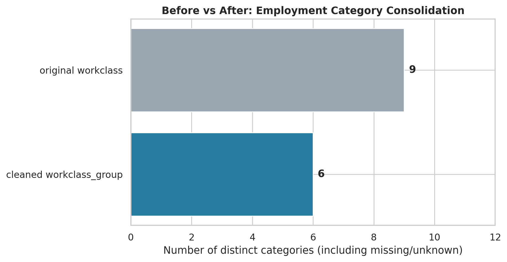
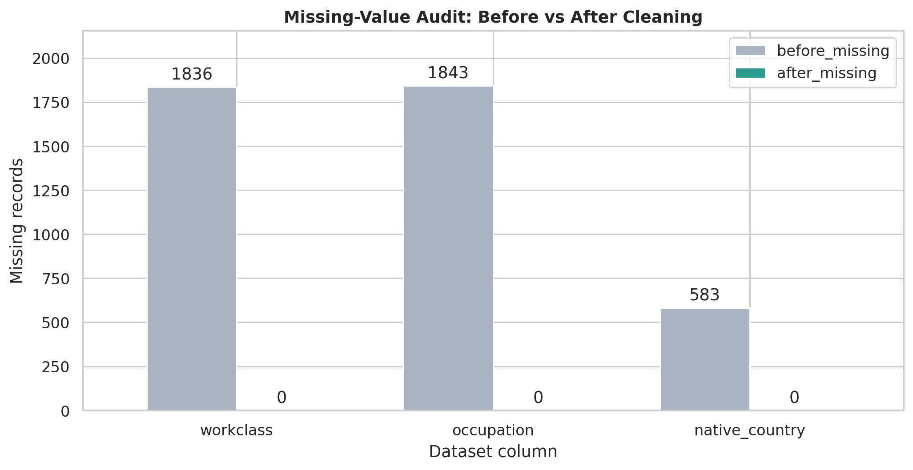
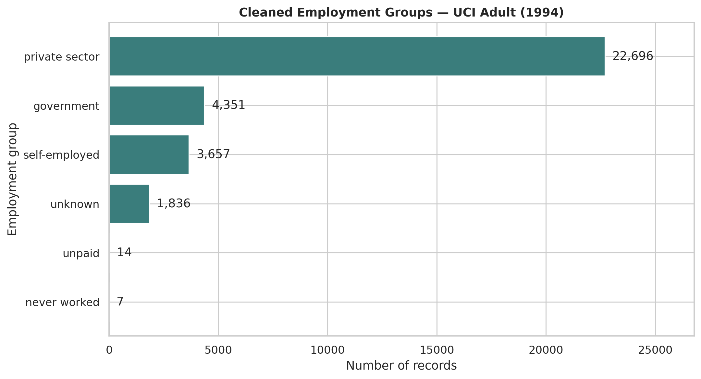

# SurveyLens — Week 2: Clean Responses and Engineer Features

**SkillMe Data Science Virtual Internship · Week 2**  
**Dataset:** [UCI Adult Census Income](https://archive.ics.uci.edu/dataset/2/adult) (historical, 1994 US Census-derived records)  
**Notebook:** [SurveyLens_Week2_Data_Cleaning.ipynb](SurveyLens_Week2_Data_Cleaning.ipynb)

## Project overview

Week 2 builds on the [Week 1 exploratory analysis](../Week-1-Data-Exploration/) by standardizing categorical text, treating missing information, engineering interpretable features, and checking whether the original statistics remain consistent. The unmodified source data are retained as `df_raw` in the notebook.

## Skills and methods

- **Text standardization:** `clean_categories(df)` uses `.str.strip()`, `.str.lower()`, and an explicit mapping dictionary to normalize text and create broader employment groups.
- **Missing values:** `workclass`, `occupation`, and `native_country` are filled with `unknown`, keeping records without inventing personal details. Numeric columns did not require imputation.
- **Feature engineering:** `pd.cut()` adds six `age_band` categories while retaining the original age column.
- **One-hot encoding:** `pd.get_dummies()` transforms `workclass_group`, `education`, and `marital_status` in a separate encoded dataset.
- **Consistency checks:** Education-based average working hours and group sizes are compared against the original dataset.
- **Validation:** Assertions check missingness, accepted group labels, preserved row counts and numerical values, and CSV reload integrity.

## Results

| Metric | Verified result |
|---|---:|
| Original dataset | 32,561 rows × 15 columns |
| Cleaned dataset | 32,561 rows × 17 columns |
| One-hot encoded dataset | 32,561 rows × 43 columns |
| Original employment labels (including missing) | 9 |
| Cleaned employment groups (including `unknown`) | 6 |
| Missing `workclass` entries | 1,836 → 0 |
| Missing `occupation` entries | 1,843 → 0 |
| Missing `native_country` entries | 583 → 0 |
| Remaining missing values in cleaned CSV | 0 |

**Engineered age groups:** `17-24`, `25-34`, `35-44`, `45-54`, `55-64`, `65+`.

**Rechecked Week 1 comparison:** The `Prof-school` and `HS-grad` education groups have mean weekly working hours of **47.43** and **40.58**, respectively; the comparison results were unchanged after cleaning.

## Visualizations

### Workclass categories: before and after grouping



### Missing data: before and after treatment



### Cleaned employment-group distribution



## Files

```text
Week-2-Data-Cleaning/
├── SurveyLens_Week2_Data_Cleaning.ipynb
├── README.md
├── requirements.txt
├── data/
│   ├── survey_clean.csv
│   └── survey_encoded.csv
└── outputs/
    ├── 01_workclass_before_after.png
    ├── 02_missing_values_before_after.png
    └── 03_cleaned_workclass_distribution.png
```

`data/survey_clean.csv` is the main Week 2 deliverable; `survey_encoded.csv` is a supplementary version prepared for later analysis.

## Run the notebook

1. Open `SurveyLens_Week2_Data_Cleaning.ipynb` in [Google Colab](https://colab.research.google.com/).
2. Select **Runtime → Run all**.
3. Review the printed before/after statistics and checks. The notebook saves fresh CSVs and plots under `SurveyLens_Week2_Project/`.

For a local Jupyter environment, install dependencies with `pip install -r requirements.txt`. The source dataset loads directly from the [UCI repository](https://archive.ics.uci.edu/ml/machine-learning-databases/adult/adult.data), so internet access is required for a fresh run.

## Cleaning decisions and limitations

The original employment labels are mostly consistent. The reduction from **9** to **6** categories results from **deliberate consolidation** (for example, government subtypes are grouped together), not from correcting fabricated spelling errors. The detailed normalized `workclass` field is still retained.

`unknown` means the information was not recorded; it does not recover missing answers. The dataset is historical, and observed group differences are descriptive, not causal or representative of today's population.

## References

- [UCI Adult dataset](https://archive.ics.uci.edu/dataset/2/adult)
- [Pandas string methods](https://pandas.pydata.org/docs/user_guide/text.html)
- [Pandas cut](https://pandas.pydata.org/docs/reference/api/pandas.cut.html)
- [Pandas get_dummies](https://pandas.pydata.org/docs/reference/api/pandas.get_dummies.html)

**Author:** Dondapati Harshith  
**Repository:** [SurveyLens Data Science Internship](https://github.com/HarshithDevX/SurveyLens-DataScience-Internship)
