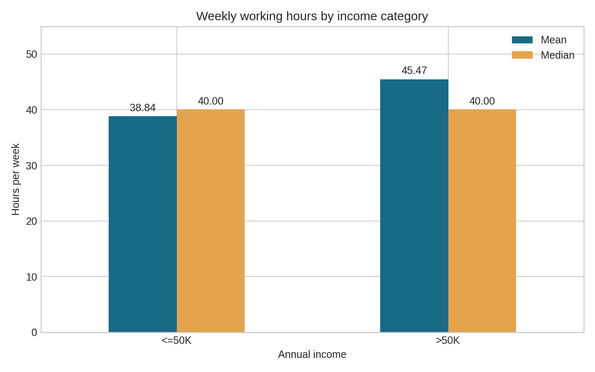
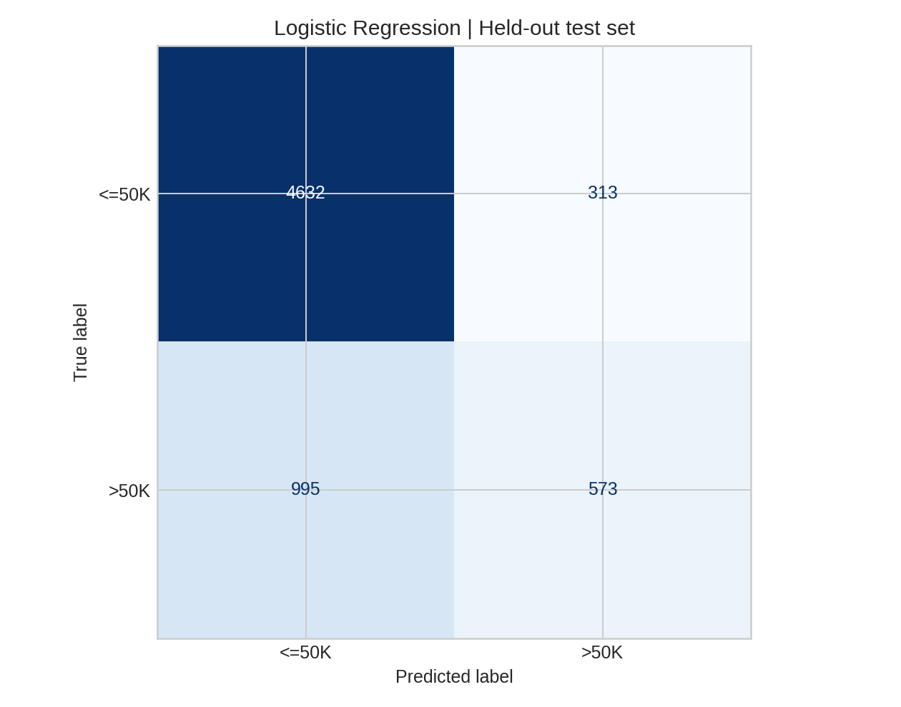
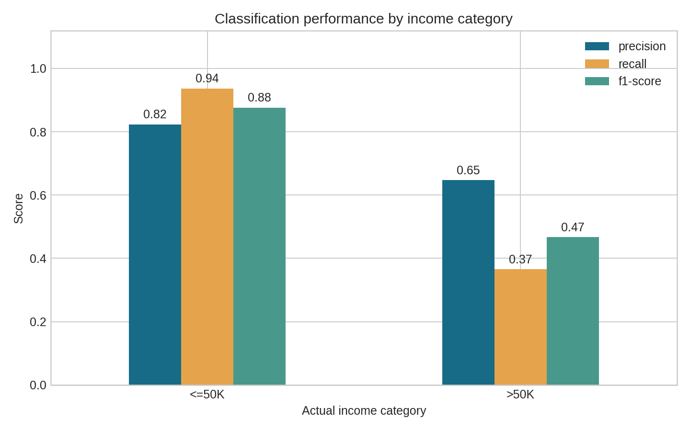

# SurveyLens — Week 3 | Statistical Analysis & Machine Learning

SkillMe Data Science Virtual Internship · Continuation of Week 2

## Run and submit (Windows)

1. Extract the ZIP. Open this folder and double-click `RUN_WEEK3.bat` (Python must already be installed; package installation may need internet). The notebook has already been executed and includes its outputs; rerunning refreshes them.
2. Copy this entire `Week-3-Statistical-Analysis-and-ML` folder into the root of your existing SurveyLens-DataScience-Internship GitHub repository. From the repository root, run:
   ```bash
   git add Week-3-Statistical-Analysis-and-ML
   git commit -m "Complete SurveyLens Week 3 statistical analysis and ML"
   git push
   ```
3. Open the notebook on GitHub and verify the outputs are visible. The repository should be public for review. Use `LinkedIn_Post_Draft.txt` and attach the three PNGs in `outputs/`. Verify that the project link works, select the official @SkillMe mention and publish. Submit the LinkedIn **post** link on the internship dashboard.

Alternative: in VS Code open the notebook, choose a Python kernel with the requirements installed, then Run All and save. In Colab upload the notebook and the bundled CSV to `data/survey_clean.csv` under the runtime working directory before running; download the executed notebook and outputs afterwards.

## Objective and methodology

Compare weekly working hours across income groups and predict income category using five features: age, hours per week, education, workclass group and occupation. Welch's t-test checks the mean difference; Cohen's d measures its standardized size. An 80/20 stratified split uses random state 42. The pipeline fits scaling and one-hot encoding on training data only. Logistic Regression is evaluated on the test partition, with Random Forest as the optional stretch goal.

## Verified results

See [numeric results and interpretation](outputs/RESULTS.md), [classification report](outputs/classification_report.csv), [confusion matrix counts](outputs/confusion_matrix.csv), [significance test](outputs/significance_test.csv) and [model comparison](outputs/model_comparison.csv). Results may vary slightly with library versions.







## Deliverable checklist

- Group comparison with mean, median and numerical difference
- Welch t-test and effect size
- Five features, one binary target, training-only preprocessing
- Logistic Regression with held-out predictions
- Precision, recall, F1 and confusion matrix for both classes
- Four-sentence interpretation referencing actual counts
- Optional Random Forest comparison

## Data provenance and limitations

`data/survey_clean.csv` is the actual Week 2 exported dataset (32,561 rows, 17 columns), copied unchanged. Original source: [UCI Adult Census Income](https://archive.ics.uci.edu/dataset/2/adult). Historical, unweighted, observational results are not causal or current population estimates. This educational classifier is not suitable for high-stakes decisions. No fabricated records or metrics are used.
